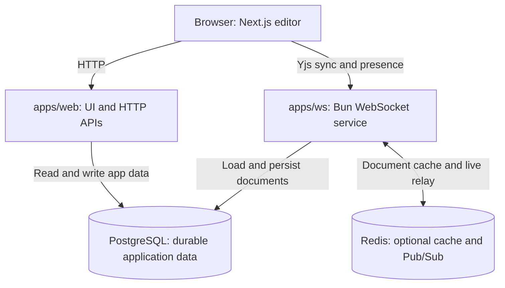

# Conflux

Conflux is a collaborative workspace for teams to write and organize shared
documents. Members work in workspaces, create rich-text pages, edit together in
real time, leave threaded comments, and review or restore earlier versions.

**Built with OpenAI Codex.** I prompted and directed development and verified
the result.

## What’s here

- **Accounts and workspaces:** registration, profiles, workspace membership,
  invitations, and role-based access.
- **Pages and editing:** rich-text documents with formatting and live
  collaborator cursors and presence.
- **Comments:** anchored threads and replies, with resolve and reopen actions.
- **History:** manual snapshots, restore, and optional automatic snapshots.
- **Access control:** the collaboration service checks membership when a
  connection opens and rechecks access while it stays open.

## Screenshots and demos

See the [screenshots and demos](screenshots/README.md) for a visual walkthrough
of account setup, editing and collaboration, comments, snapshots, and workspace
management.

**Live application:** [Conflux](https://conflux-two-inky.vercel.app/)

The web app is deployed, but live collaboration is currently unavailable
because the WebSocket service is not deployed. I couldn't find a free hosting
option for the WebSocket service.

**Working demo video:** [Conflux demo](https://youtu.be/u07-9lkgEeA)

## Submission materials

- **Repository and setup:** This repository contains the source code and the local setup instructions below.
- **Architecture and data/API documentation:** The architecture diagram and service responsibilities are in this README. See the [product specification](SPEC.md), [WebSocket service notes](apps/ws/README.md), and [frontend guide](apps/web/FRONTEND.md) for data, API, and implementation details.
- **Tests and results:** The API test results are recorded under [Test evidence](#test-evidence): 90 passing tests across 8 files. Build, lint, type-check, and seed commands are also listed there. No performance or accuracy benchmark is claimed.
- **Final presentation (10 minutes):** Cover the collaboration problem, design and architecture, implementation challenges, demo and test results, current limitations, and next steps. The linked demo video and this README provide a presentation outline.
- **Individual reflection:** Each intern should include their own short reflection in the presentation or submission, describing what they learned, what they personally owned, and what they would improve next. For this project, useful areas include real-time synchronization, persistence, access control, and collaboration reliability.

**Development attribution:** Conflux was built with OpenAI Codex using prompts directed by me. I reviewed and verified the implementation and demo flows.

## How the system works



When a client opens a page, `apps/ws` authenticates the signed connection,
checks workspace membership, and loads the Yjs document. It uses a Redis
document cache when available and falls back to persisted updates in
PostgreSQL. Accepted document updates are written to PostgreSQL; Redis caches
the resulting document state. With Redis configured, Pub/Sub relays live
document and presence updates between WebSocket processes. Each process still
keeps its active Yjs room in memory. PostgreSQL is the durable source of truth.

| Part | Responsibility |
| --- | --- |
| `apps/web` | Next.js interface, authentication and HTTP APIs |
| `apps/ws` | Bun WebSocket service, Yjs rooms, permissions, persistence, snapshots |
| `packages/database` | Prisma schema, database client, and migrations |
| `packages/seed` | Repeatable demo users, workspace, and page data |
| PostgreSQL | Durable application data and incremental Yjs updates |
| Redis (optional) | Document cache and cross-process Pub/Sub |

## Engineering choices

During development, I organized the web app, collaboration service, database,
and seed tooling as a Turborepo monorepo. Its task graph captures package
dependencies, runs independent work in parallel, and caches configured build
outputs so unchanged work can be reused locally. The task definitions live in
[`turbo.json`](turbo.json). See [Turborepo's caching guide](https://turborepo.dev/docs/crafting-your-repository/caching)
for how the cache works.

I chose Cloudflare R2 for profile photo storage and kept the existing AWS S3
client. R2 exposes an S3-compatible API, so the app can use the same SDK and
configure an R2 endpoint. R2 also has a monthly free tier and free egress,
which makes it a lower-cost fit for this project's small uploads; storage and
request usage above the included tier can still incur charges. See Cloudflare's
[S3 compatibility guide](https://developers.cloudflare.com/r2/api/s3/api/) and
[current pricing](https://developers.cloudflare.com/r2/pricing/). The upload
implementation is in [`apps/web/app/actions/profile.ts`](apps/web/app/actions/profile.ts).

For document data, PostgreSQL stays authoritative while Redis is optional.
That keeps persistence independent of the cache and gives the collaboration
service a fast document cache and a live relay between WebSocket processes.

## Run locally

### Requirements

- Node.js 26.12.1 or newer
- Bun 1.4.0
- Docker Compose, or a reachable PostgreSQL database

Install dependencies and create the local environment files:

```sh
bun install
cp .env.example .env
cp .env.example packages/database/.env
cp .env.example apps/web/.env
```

Set `DEBUG_MODE=true` in the root `.env` (and in `apps/web/.env` if you start
the web app separately) and restart the services to enable diagnostic logs for
WebSocket collaboration, snapshot restoration, and browser connection events.
Leave it as `false` (the default) for normal use. The web application reads the
flag when Next.js starts/builds, so restart or rebuild after changing it.
Error logs remain enabled regardless of this setting.

The WebSocket service reads the root `.env`; the web app and database package
also read their own `.env` files. Use the same `AUTH_SECRET` in the web app and
WebSocket service. Set it to a random value with at least 32 characters; the
example placeholder is rejected.

Start PostgreSQL and Redis with Compose:

```sh
docker compose up -d
```

Redis is optional. For a single WebSocket process, the app can run without it;
Redis adds the document cache and cross-process message relay. Initialize the
database and start the app:

```sh
bun generate
bun db:push
bun dev
```

To populate a local review workspace, run:

```sh
bun db:seed
```

This creates `owner@conflux.local` and `editor@conflux.local`, a workspace,
and a welcome page. New demo accounts use `conflux-demo` by default. Set
`SEED_DEMO_PASSWORD` in the root `.env` to override it with a password of at
least 12 characters. Reruns preserve existing account passwords. See
[the seed package](packages/seed/README.md) for details.

Open <http://localhost:3000>. The WebSocket service listens on port `8008` by
default. Set `NEXT_PUBLIC_COLLAB_URL` if it runs at a different address. To
review collaboration with two users locally, open the same page in two
browsers or browser profiles and sign in as separate workspace members.

## Current limitations

- Redis Pub/Sub relays updates between WebSocket processes, but this is not yet
  a robust multi-server editing setup. Pub/Sub is transient, and simultaneous
  edits handled by different processes can hit a stale-room persistence check.
  For reliable collaboration, run one WebSocket process for now. Redis remains
  useful for document caching in that setup.
- Offline edits are held in browser memory, not IndexedDB. They are not
  guaranteed to survive a reload or browser crash.
- Comment anchors use stored offsets and quoted text; they can become stale as
  the document changes. Comment changes are not pushed live to other clients.
- Invitations are managed in the app but are not delivered by email.
- Automatic snapshots are off by default. When enabled, the service checks
  every 15 minutes and retains the latest 20 per page. A snapshot includes
  persisted updates only.
- The collaboration service is a long-lived WebSocket process and is not
  suitable for serverless deployment. It currently has a development command,
  but no separate production start or health-check command.

## Useful commands

## Test evidence

Run the API test suite from the repository root:

```sh
bun --cwd apps/web run test:api
```

It covers authentication, users, workspaces and membership, pages, invitations,
comments, and snapshot history. The suite passed all 90 tests across 8 files:

```
 Test Files  8 passed (8)
      Tests  90 passed (90)
   Start at  17:24:59
   Duration  11.73s (tests 91%, import 9%)
```

```sh
bun build
bun lint
bun check-types
bun db:seed
```

## Project guide

- [Product specification](SPEC.md): target behavior and data/API model; some
  requirements remain planned or incomplete.
- [WebSocket service notes](apps/ws/README.md): local use and room behavior.
- [Frontend guide](apps/web/FRONTEND.md): web app implementation details.
