# Screenshots and demos

This folder contains a visual walkthrough of Conflux, from account setup to collaborative editing and workspace administration. Screenshots and MP4 demos are displayed below in feature groups.

## 01–04 · Getting started

### 01 · Register

New account registration.

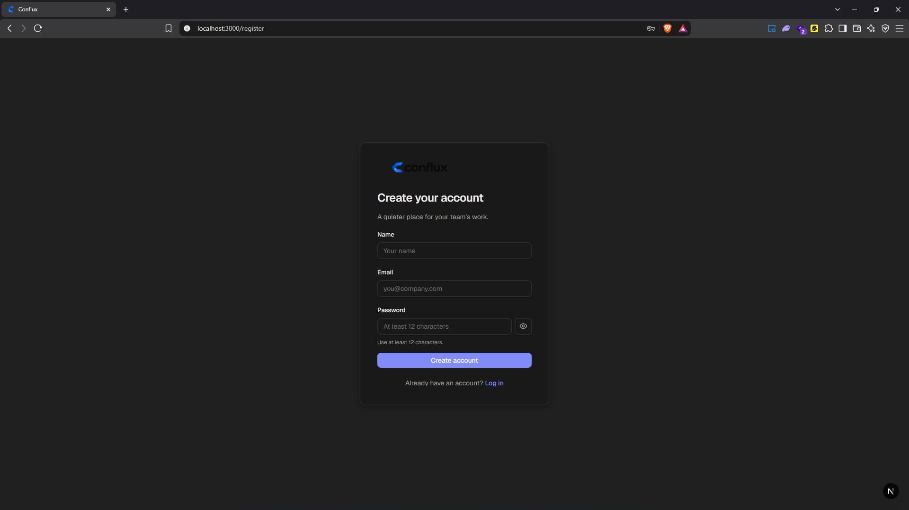

### 02 · Login

Sign-in screen for returning users.

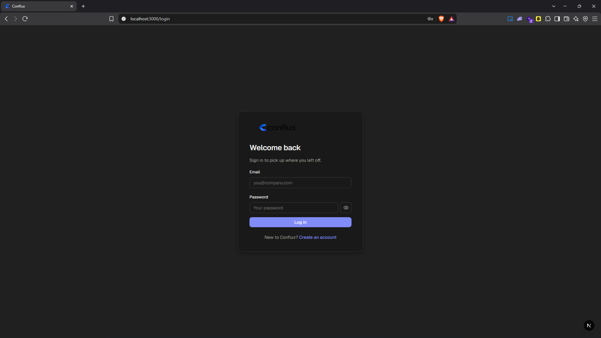

### 03 · Onboarding

First-run onboarding and workspace setup.

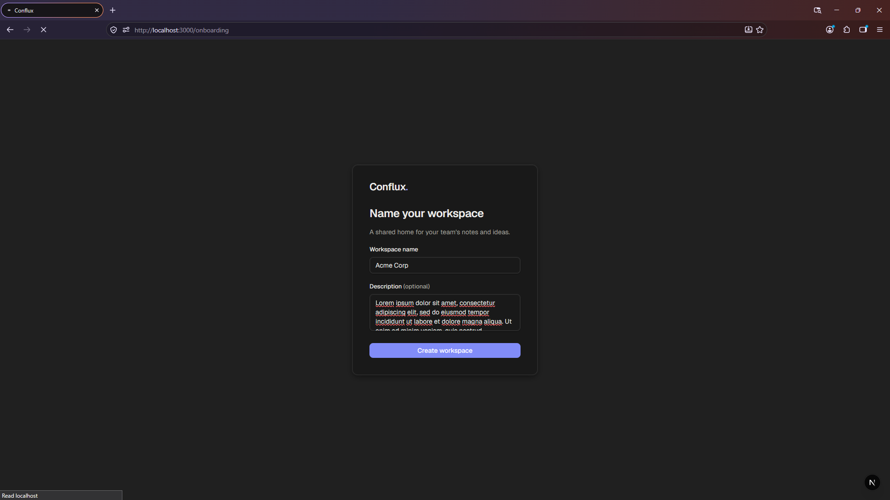

### 04 · Home

Main workspace landing view.

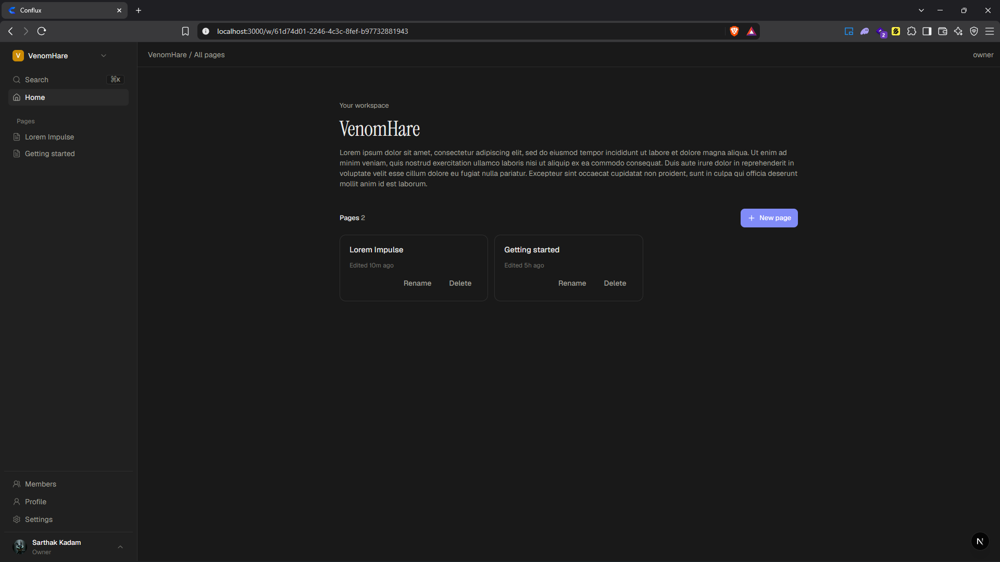

## 05–07 · Pages and collaboration

### 05 · New page

Creating a page in a workspace.

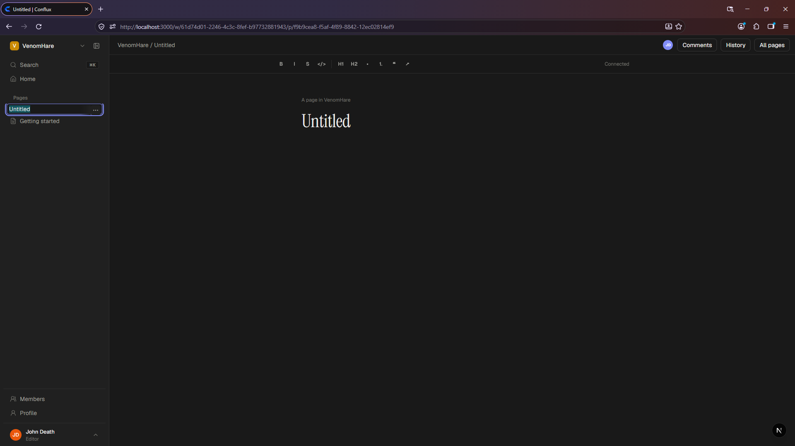

### 06 · Live cursor and selection

Other collaborators’ live cursors and text selections in the editor.

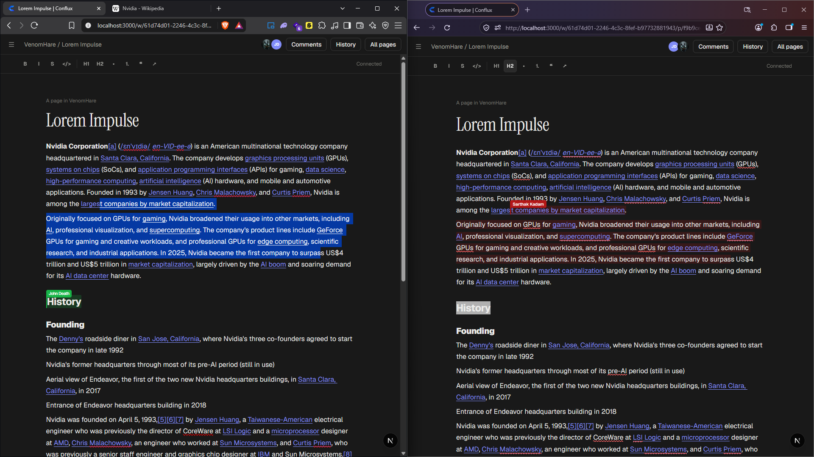

### Collaboration demo

Video walkthrough of multiple people editing together in real time.

https://github.com/user-attachments/assets/f3535fe5-fd34-43eb-8846-f6de5b0f805b

## 08–11 · Comments and page history

### 08 · Open comments

An open, threaded comment attached to page content.

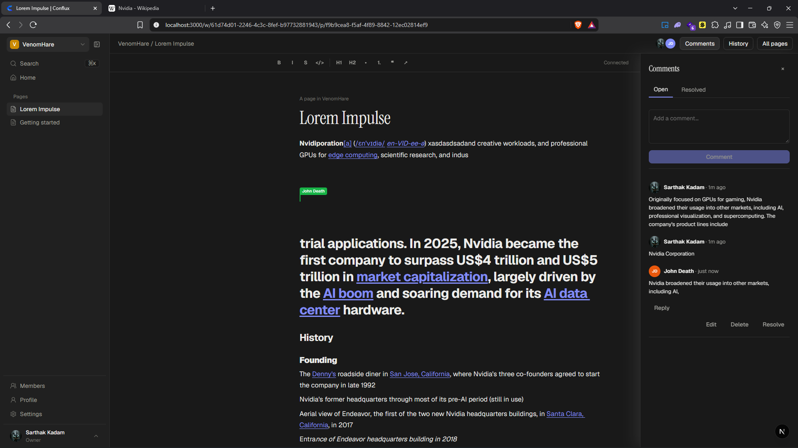

### 09 · Resolved comments

A resolved comment thread.

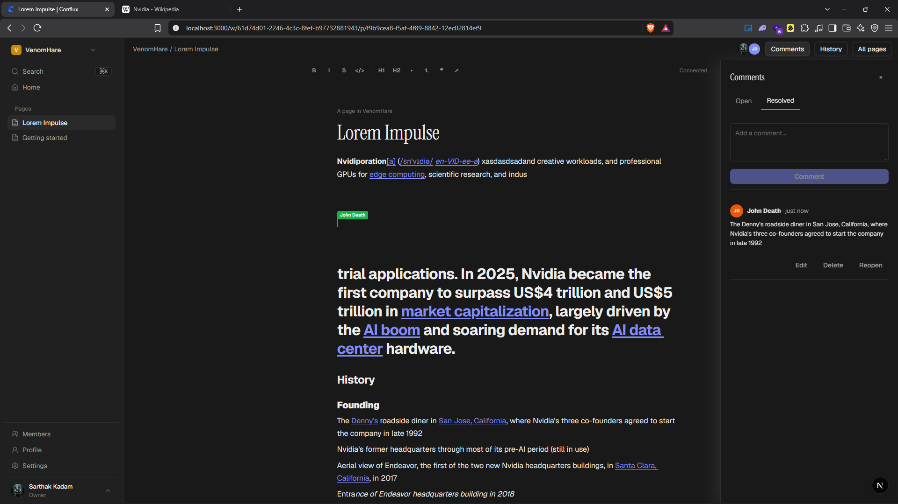

### 10 · Automatic snapshots

The automatic snapshot setting for a page.

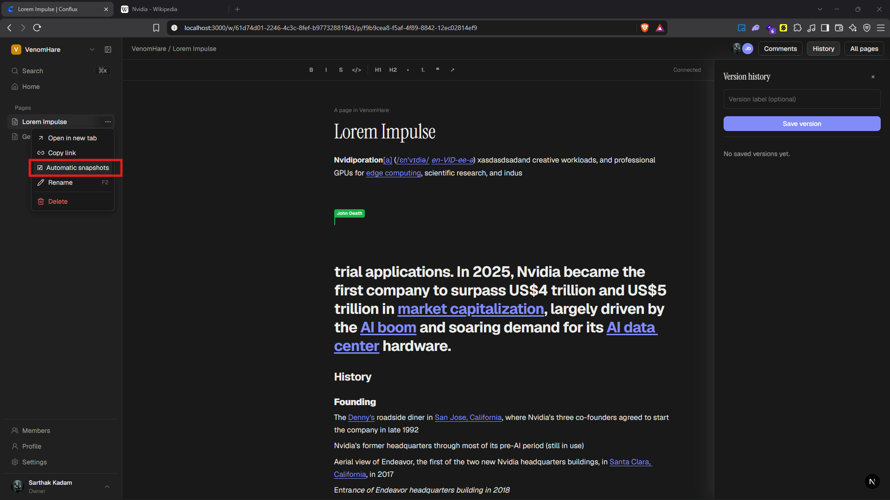

### 11 · Snapshot history

Snapshot history for reviewing earlier page versions.

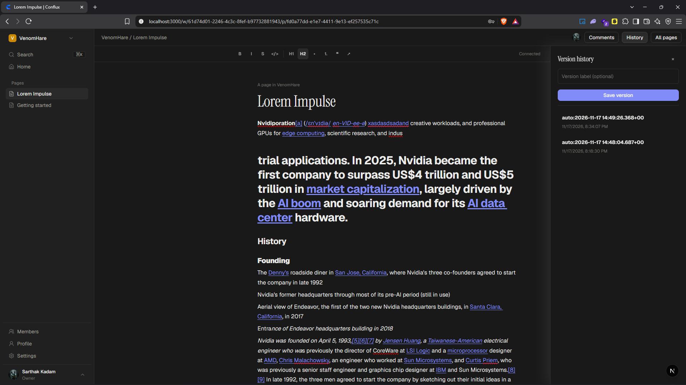

### Restore snapshot demo

Video walkthrough of restoring a page from a snapshot.

https://github.com/user-attachments/assets/a78f2569-071c-4742-bd5a-d8c5f6691b85

## 13–18 · Workspace and account management

### 13 · Profile settings

User profile settings.

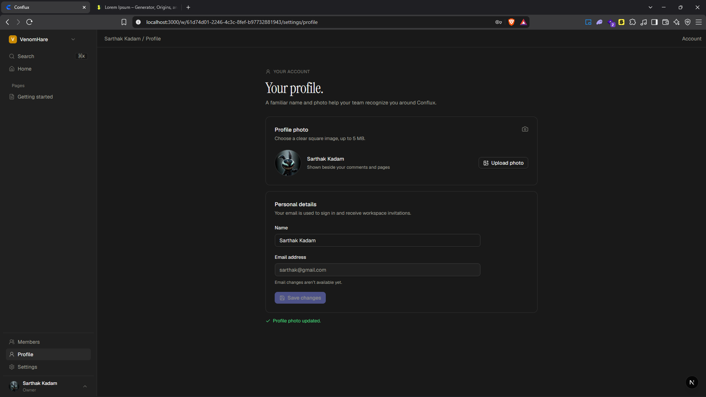

### 14 · Member management

Workspace member list and role management.

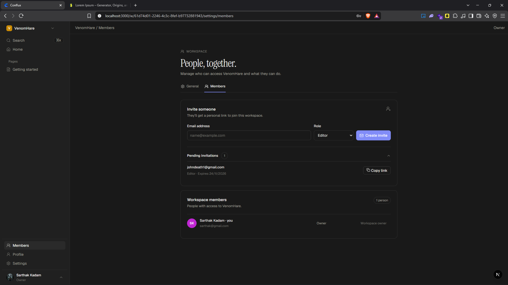

### 15 · Invitations

Managing invitations to join a workspace.

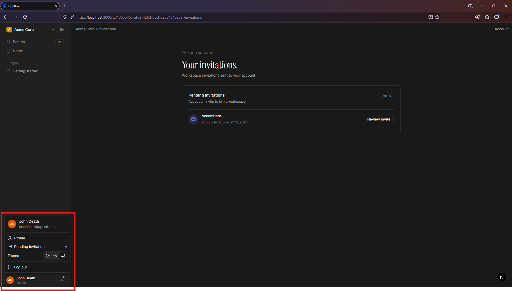

### 16 · Accept an invitation

Invitation acceptance screen for a prospective member.

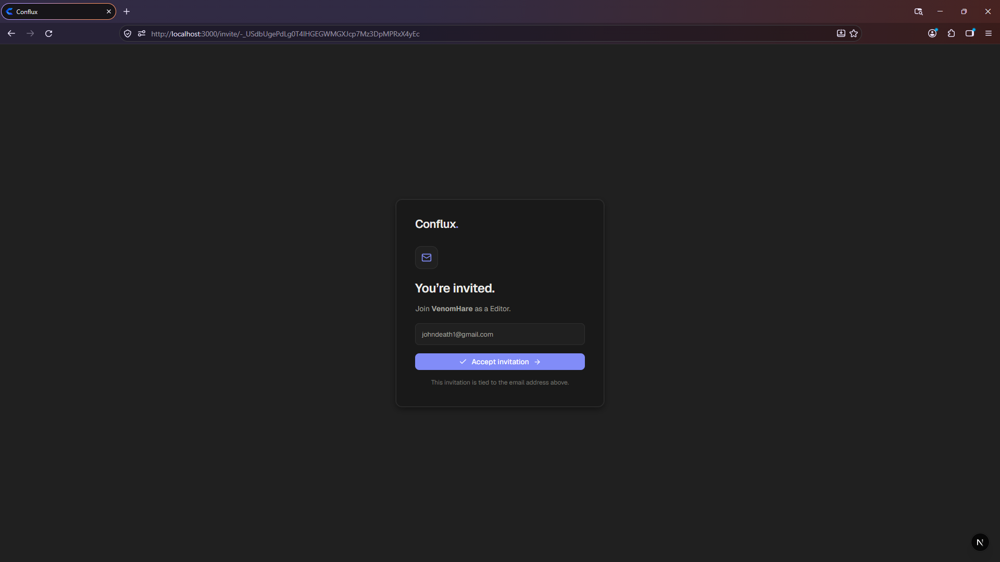

### 17 · Multiple workspaces

Switching between multiple workspaces.

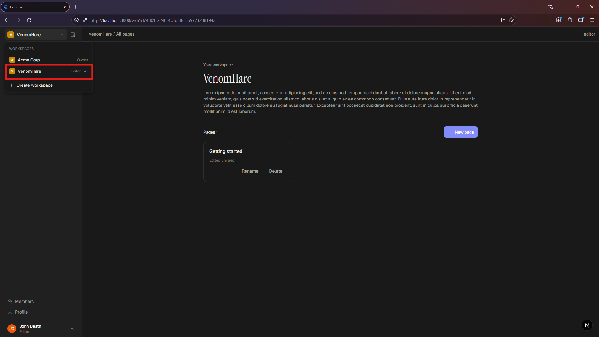

### 18 · Quick access menu

Quick-access menu for navigating workspace content and actions.

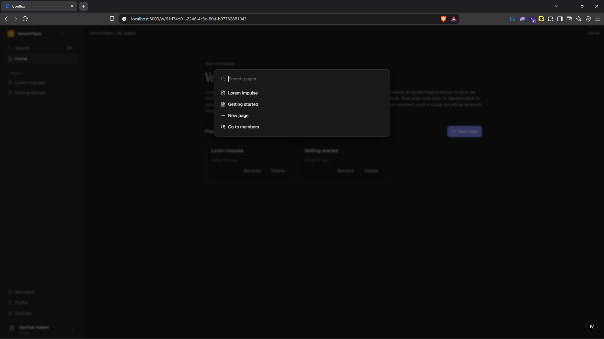

## Notes

- Screenshots and demos use Markdown image syntax so they display directly in the README viewer.
- The numbers are kept in filenames to make each asset easy to reference. The sequence skips 12, and both the automatic-snapshot screenshot and snapshot-restoration video use the `10` prefix.
- Invitation management is shown in the app; invitations are not sent by email.
